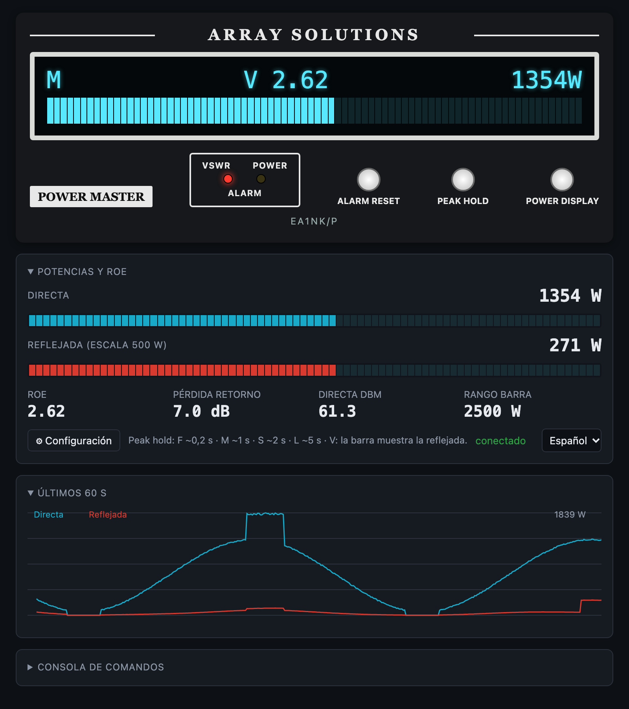
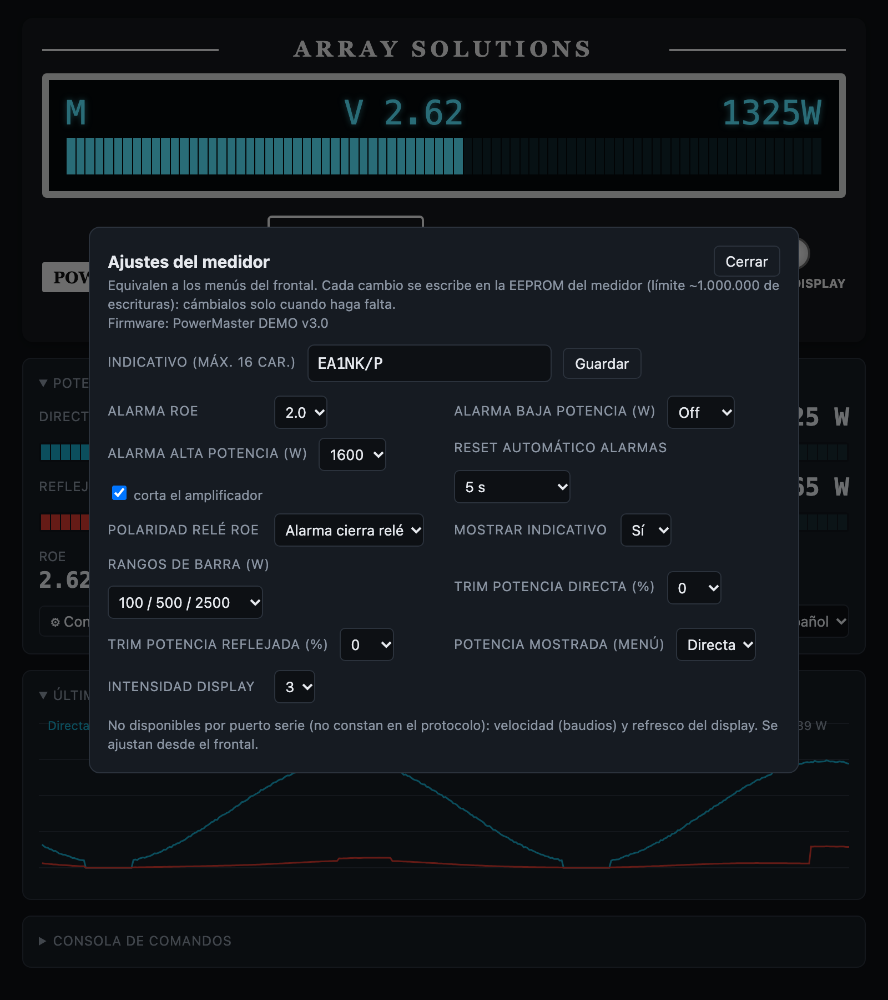

# Clase NodeJS para Powermaster
2023 SCQ Devices - EA1NK

### Descripción

Clase JavaScript sencilla para controlar de forma remota el medidor de ROE (VSWR) PowerMaster de Array Solutions desde una aplicación NodeJS.

### Instalación

```
npm install
```

### Uso

```js
const PowerMaster = require("./powermaster.js");
const pm = new PowerMaster("/dev/ttyUSB0", 38400); // 38400 es la velocidad por defecto del medidor

pm.sendCommand("v?").then(console.log);   // versión del firmware
pm.on("realtime", (d) => console.log(d)); // {forwardPower, reflectedPower, vswr, ...}
pm.setRealtime(3);                        // D3: datos en tiempo real cada 140 ms
```

Los comandos se envían empaquetados automáticamente como `STX + comando + ETX + CRC + CR` y de uno en uno, porque el medidor no acepta un comando nuevo hasta devolver la respuesta anterior. `sendCommand` devuelve una promesa con la respuesta; si el medidor no contesta en 2 segundos, la promesa falla por timeout.

### Eventos

- `realtime`: paquete de datos en tiempo real (`Dx`) ya interpretado.
- `message`: mensaje espontáneo del medidor, por ejemplo un cambio hecho desde su menú.
- `error`: error del puerto serie.

### Interfaz web

Interfaz web básica (ROE, potencias, alarmas, gráfica de 60 s y consola de comandos):

```
node server.js /dev/ttyUSB0 [baudios] [puertoHTTP]   # medidor real
npm run demo                                          # medidor simulado, sin hardware
```

Se abre en http://127.0.0.1:3000. Solo escucha en localhost porque el medidor no tiene autenticación, y bloquea los comandos de flash, bootloader y fábrica (`e`, `p`, `r`, `x`).

La interfaz está en español e inglés (selector en la propia interfaz, o `?lang=es` / `?lang=en`). El modo demo simula cada minuto una desadaptación de ROE y un pico de potencia para poder ver las alarmas.

Los documentos del protocolo serie y el manual usados para la interfaz son del **PowerMaster I** (firmware v2/v3). No está verificado que el PowerMaster II use exactamente el mismo protocolo serie; los comandos que no conozca los responde con `N` y la interfaz los ignora. (`?model=2` en la URL cambia las pocas etiquetas que difieren en el manual del PowerMaster II: logo, tiempos de reset automático de alarmas, visualización Rev & Fwd.)





### Puerto serie

9600, 19200 o 38400 baudios (se elige en el menú del medidor; por defecto 38400). El RS232 y el USB no pueden usarse a la vez: el RS232 se desactiva mientras el USB está activo.

### Pruebas

No necesitan el medidor conectado:

```
npm test
```

### Aviso

Los comandos que cambian opciones de menú solo deben enviarse a petición del operador, no de forma automática: la EEPROM del medidor admite unos 1.000.000 de escrituras.
