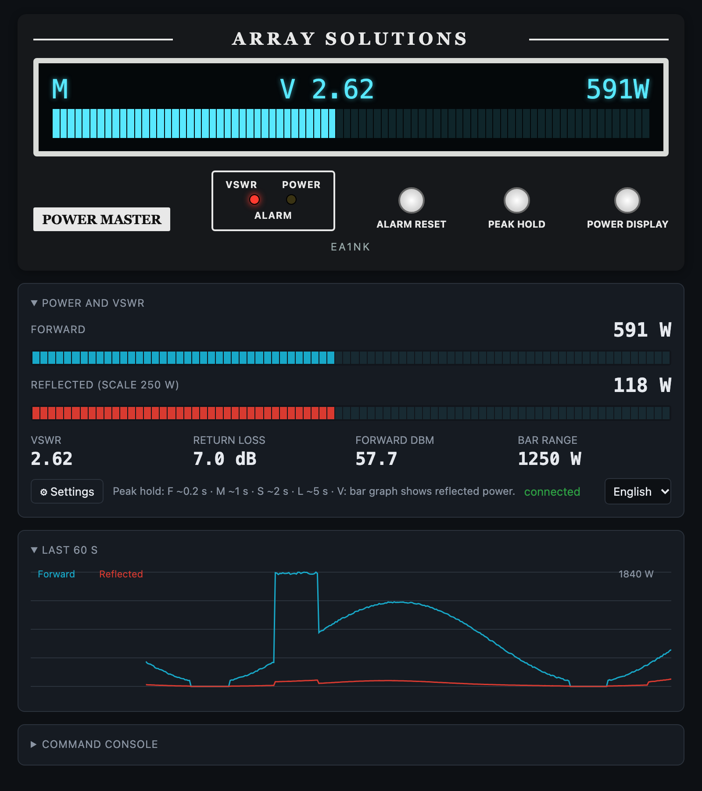
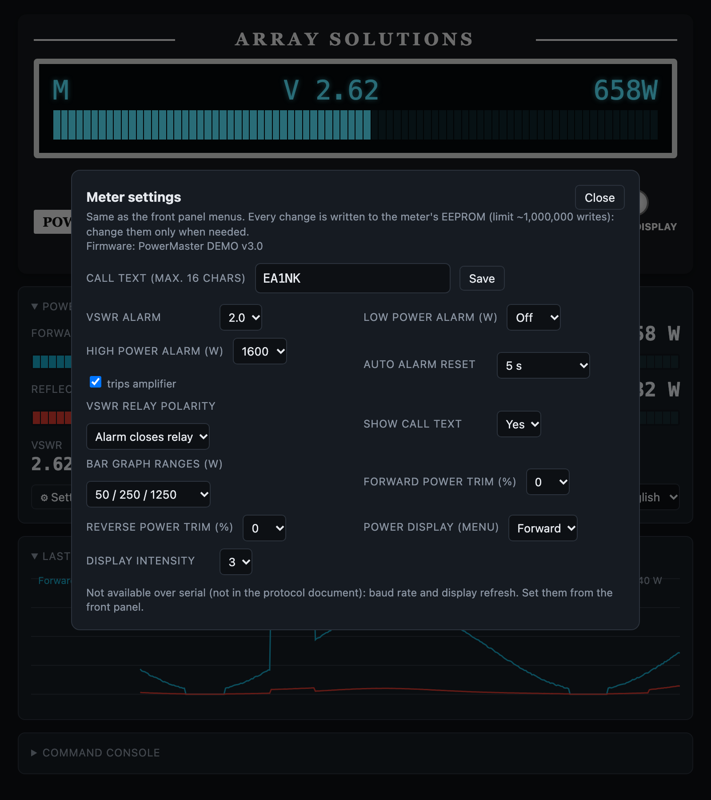

# Powermaster NodeJS class
2023 SCQ Devices - EA1NK

### Description:

Simple javascript class to remote control the Array Solution PowerMaster VSWR Meter from a NodeJS app.

### Usage:
```
npm install
```
```
const PowerMaster = require("./powermaster.js")
const pm = new PowerMaster("/dev/ttyUSB0", 38400); // 38400 is the meter default

pm.sendCommand("v?").then(console.log);   // version string
pm.on("realtime", (d) => console.log(d)); // {forwardPower, reflectedPower, vswr, ...}
pm.setRealtime(3);                        // D3: real time data every 140 ms
```
Commands are wrapped as STX + payload + ETX + CRC + CR automatically and sent one at a time.
Basic web UI (VSWR, powers, alarms, 60 s chart, command console):

```
node server.js /dev/ttyUSB0 [baud] [httpPort]   # real meter
npm run demo                                     # simulated meter, no hardware
```

Open http://127.0.0.1:3000. It only listens on localhost (the meter has no authentication) and blocks the flash, bootloader and factory commands (`e`, `p`, `r`, `x`).

Serial: 9600, 19200 or 38400 baud (selectable in the meter menu, default 38400). RS232 and USB cannot be used at the same time: the RS232 port is disabled while USB is active.

The UI is available in English and Spanish (selector in the UI, or `?lang=en` / `?lang=es`). The demo simulates a VSWR mismatch and a power surge every minute so the alarms can be seen.

The serial protocol documents and the manual used for the UI are for the **PowerMaster I** (firmware v2/v3). Whether the PowerMaster II uses exactly the same serial protocol is unverified; commands it does not know are answered with `N` and the UI ignores them. (`?model=2` in the URL switches the few labels that differ in the PowerMaster II manual: logo, auto alarm reset times, Rev & Fwd display.)





Tests (no hardware needed): `npm test`
